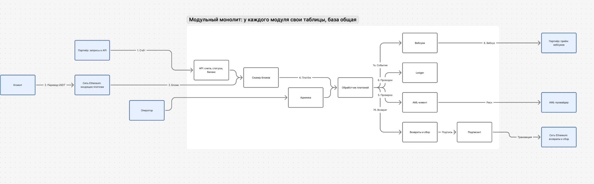
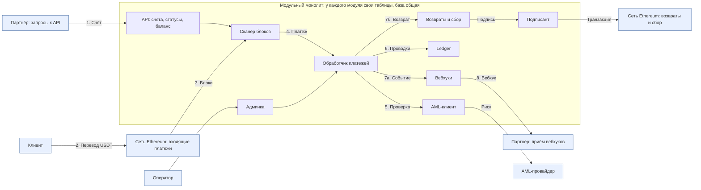

# Схема взаимосвязи компонентов

Приложение к [дизайн-документу](design.md), раздел 1.1. Синие блоки — внешние участники, в рамке — модули сервиса. Партнёр и сеть Ethereum показаны дважды, слева как источник и справа как получатель, чтобы поток читался слева направо.

Исходник схемы (Mermaid)

## Шаги одного платежа

1. Партнёр создаёт счёт через API и получает депозитный адрес и сумму. Адреса счетов API передаёт сканеру.
2. Клиент переводит USDT на депозитный адрес.
3. Сканер читает блоки и находит событие перевода на наш адрес.
4. Когда платёж проходит порог подтверждений, сканер передаёт его обработчику.
5. Обработчик проверяет отправителя через AML-клиент.
6. Обработчик пишет проводки в ledger: сначала в холд, после ответа AML — зачисление или возврат.
7. Развилка по ответу AML: при низком риске (7а) платёж зачислен и событие уходит в модуль вебхуков; при высоком (7б) создаётся возврат, транзакцию подписывает подписант.
8. Партнёр получает подписанный вебхук.

Оператор через админку разбирает спорные ответы AML и отправляет возвраты.

## Границы модулей

- У каждого модуля свои таблицы; чужие таблицы он не читает и не пишет, только вызывает интерфейс соседа.
- Вызовы между модулями идемпотентны по ключу.
- Сейчас модули работают в одной транзакции базы. При выносе модуля в отдельный сервис (первые кандидаты — ledger, сканер, вебхуки) вызов становится сетевым, а порядок шагов и ключи остаются прежними.
